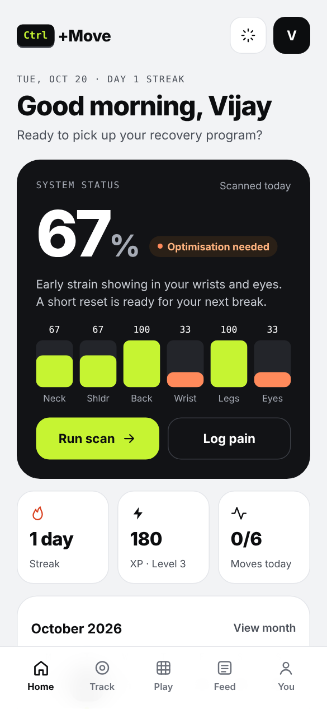
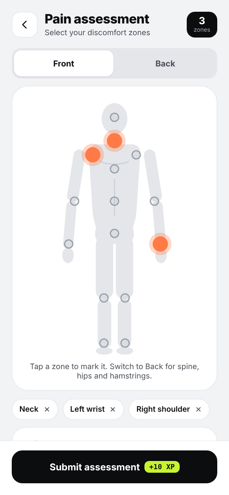
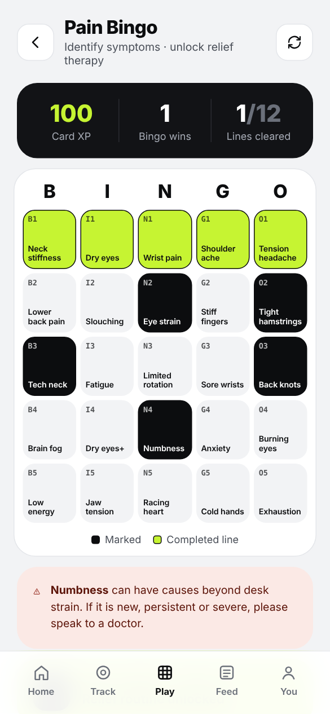

<p align="center">
  
  
  
</p>

<h1 align="center">Ctrl+Move</h1>
<p align="center"><b>Physio in your pocket. Take control before pain takes it from you.</b></p>
<p align="center">
  <a href="https://josesyson-physio.github.io/CTRL-Move/"><b>Open the live app →</b></a>
</p>

---

## Why this matters

Musculoskeletal conditions are the **leading contributor to disability worldwide**. About **1.71 billion people** live with one, and low back pain is the **single leading cause of disability in 160 countries** ([WHO, 2022](https://www.who.int/news-room/fact-sheets/detail/musculoskeletal-conditions)).

For people who work at desks, that pain rarely arrives all at once. It builds quietly: a stiff neck after long calls, tight wrists by Friday, a lower back that complains after a long drive. Healthcare usually meets it only once it hurts enough to book an appointment.

**Ctrl+Move moves that moment earlier**, to when a two-minute change still makes the difference.

## The shift we're building

| Healthcare today | With Ctrl+Move |
|---|---|
| You notice pain once it is already limiting you | A 60-second **Hardware Scan** scores six body systems and shows strain while it is still small |
| Advice is a printed sheet you lose | **Guided routines** from licensed physiotherapists, with a timer, in your pocket |
| "Take regular breaks" is easy to forget | A **work-block timer** nudges you to move every 45 minutes |
| Prevention feels like a chore | **XP, streaks, levels, Pain Bingo and Muscle Challenges** make it a daily game |
| Getting help means searching and calling around | **Match me** suggests the right physio from your own pain logs, and booking is one tap |

## What's inside

**Detect**
- **System status**: one score (0–100%) across neck, shoulders, back, wrists, hips and legs, and eyes. It's built from your latest Hardware Scan, and pain you log pulls it down.
- **Hardware Scan**: six quick self-tests, one per body system, with results by area and a recommended routine.
- **Pain map**: front and back body views with tap-to-mark zones, plus pain (0–10) and comfort steppers.
- **High-pain alert**: at 8/10 or above, the app lists the warning signs that need urgent medical care and routes to a physio. It does not push exercises.

**Move**
- **Work-block timer**: a countdown with a reminder (browser notification and vibration where supported).
- **Quick Relief**: eight physio routines, a "Recommended for you" pick from your scan, and a player with a timer and room for physio video.
- **Desk reset**: a 90-second sequence of chin tucks, wrist stretch and eye reset.

**Play**
- **Pain Bingo**: a 5×5 symptom card. Every one of the 25 symptoms opens a guide with 5 physio exercises, simple tips and safety advice from the MotionPlus *Bingo for Pain* protocol, plus a timed routine. Each line clears for +50 XP and unlocks a relief routine. XP is capped per day, so it can't be farmed. Some symptoms (numbness, racing heart) show a "see a doctor" note.
- **Muscle Challenge**: eight strength checks with XP for each.
- **Levels, streaks and 8 badges.**

**Community and care**
- **Physio feed**, Instagram-style: physio stories, reels, articles and quick tips, with likes, saves, and "Try this routine" for +25 XP.
- **Physio upload**: physios post reels, articles, tips or routines. Posts show "Pending review" until verified.
- **Consult**: specialist list with fees, hours and ratings. "Match me" ranks physios by your recent pain areas.
- **Profile**: level, badges, an activity calendar, physical parameters, data export and reset.

## Built for trust

- **Honest by design.** Ctrl+Move is a wellness and early-warning tool, not a diagnosis, and every screen that touches pain says so.
- **Private by default.** In v1, all data stays on the user's device (`localStorage`). Export gives the user their own JSON file.
- **Accessible.** Real buttons and links, 44 px touch targets, labelled icons, text contrast checked, and reduced-motion support.
- **Works offline.** Installable as an app (PWA) on Android and iOS, with offline caching.

## Run it locally

```bash
npm install
npm run dev      # http://localhost:5173
npm run build    # production build in dist/
```

The app uses React 19 and esbuild. There is no framework lock-in and no server: `dist/` is plain static files.

## Deploying

Every push to `main` builds the app and publishes `dist/` to the `gh-pages` branch through GitHub Actions (`.github/workflows/deploy.yml`). Turn on GitHub Pages once: **Settings → Pages → Source: Deploy from a branch → `gh-pages` / root**.

## Content

All clinical content lives in `src/data/`, separate from the UI, so physios can update it without touching screens. See **[CONTENT.md](CONTENT.md)** for what each file controls and which items are drafts waiting for the clinical documents.

## Project layout

```
src/
  data/         clinical content: zones, scan, challenges, routines, bingo, physios, feed
  lib/          scoring, state (saved on device), hash router
  components/   shared UI: icons, tab bar, rings, sheets, body figure
  screens/      15 screens: Splash, Home, PainMap, Bingo, Scan, ScanResult, Challenge,
                Relief, Player, Feed, Reader, PhysioUpload, Consult, Profile, Mission
public/         index.html, manifest, service worker, icons
```

## Roadmap

1. **Accounts and cloud sync** (Supabase) so progress follows the user across devices.
2. **Shared physio feed** with licence verification and an admin review queue.
3. **Real physio videos** for every routine.
4. **Camera-based scans** with on-device pose estimation to measure range of motion, not just self-report.
5. **Clinic dashboard** where physios see consenting patients' trends between visits.
6. **Employer programmes**: team challenges and anonymous team-level insights for workplaces.
7. **App stores**: an Android and iOS build with native reminders.

---

<p align="center">Made by <b>MotionPlus Physio</b> · Shimoga · Hyderabad · Bijapur</p>

## Care features (Health Shots, chat, tele-therapy, Physio Studio)

- **Health Shots**: vertical clips of 60 s or less (`/shots`). Sample shots use the animated demo figure until physios upload video.
- **Chat**: members always start the conversation; physios can only reply (`/chat`, Studio inbox).
- **Tele-therapy**: 1:1 booking requests, group sessions with seat limits, and a session room (`/consult`, `/book/:physio`, `/session/:id`).
- **Physio Studio** (`/studio`): story-insight composer with a required ethics check, Health Shot upload, exercise library (AI demo, own video, virtual demo) and group-session hosting.

These run on-device today. To go live between phones they need a backend:
auth + database (e.g. Supabase or Firebase), file storage for videos, realtime chat,
a video service for sessions (e.g. 100ms, Agora, Daily or Jitsi), and the clinic's calendar for confirmed slots.
